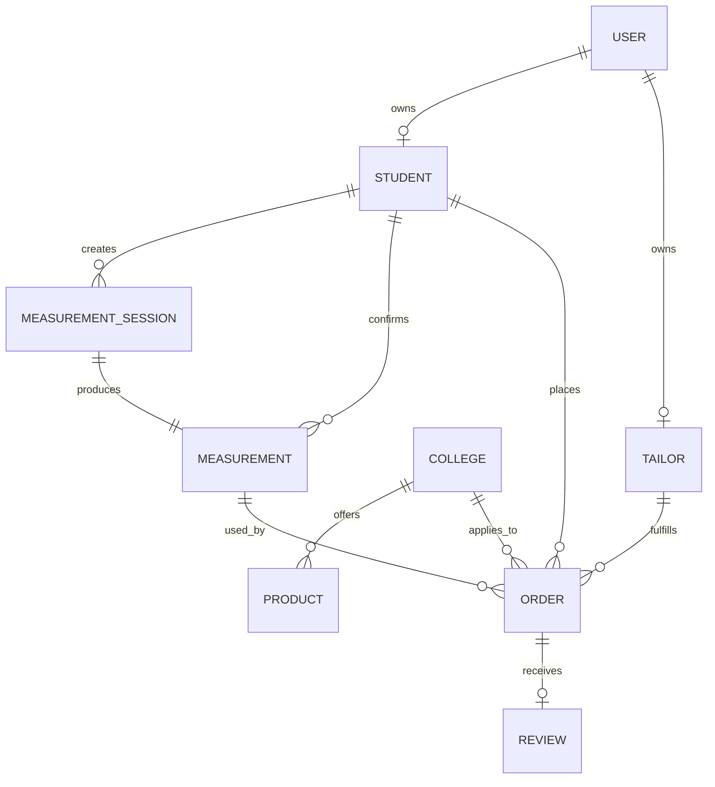
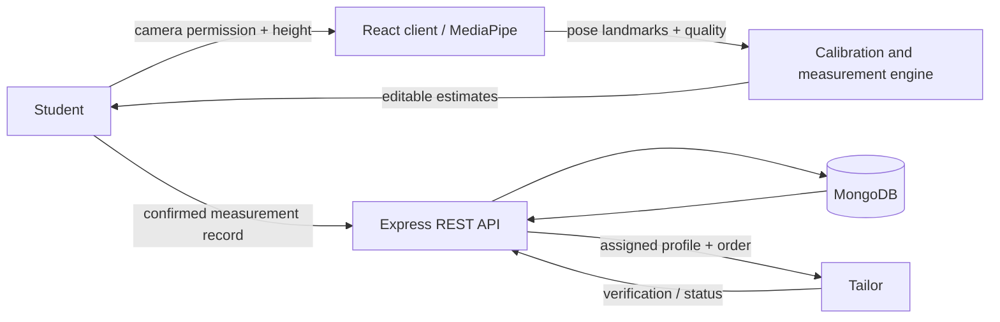
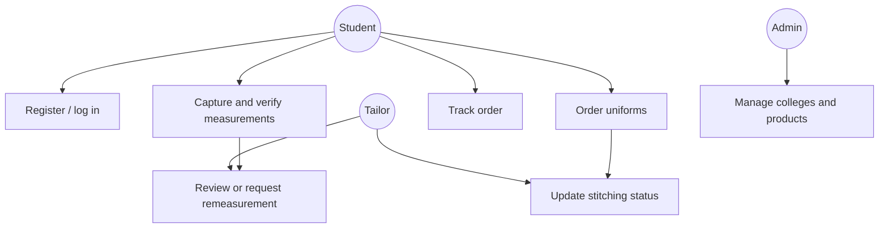
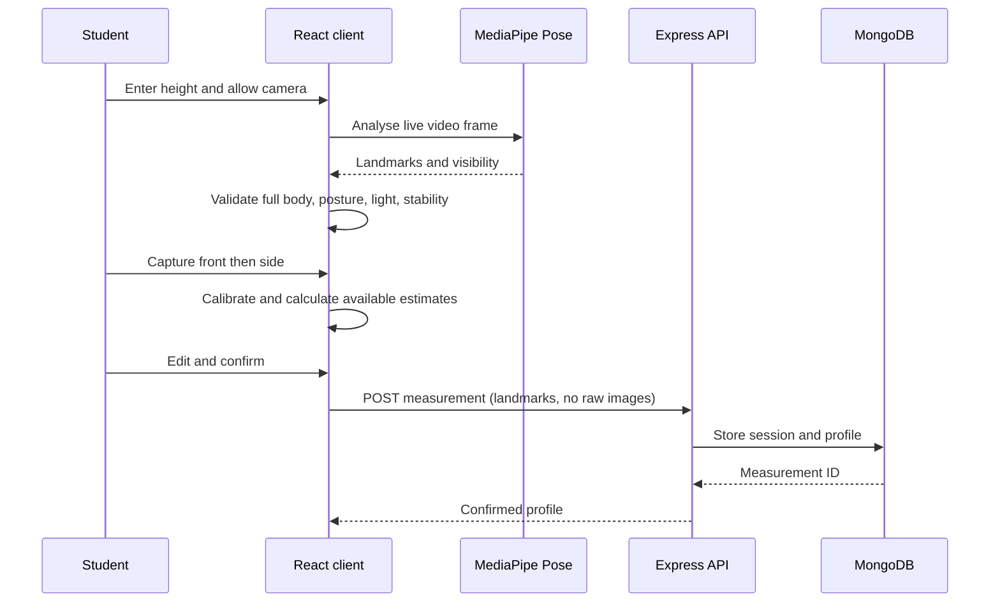
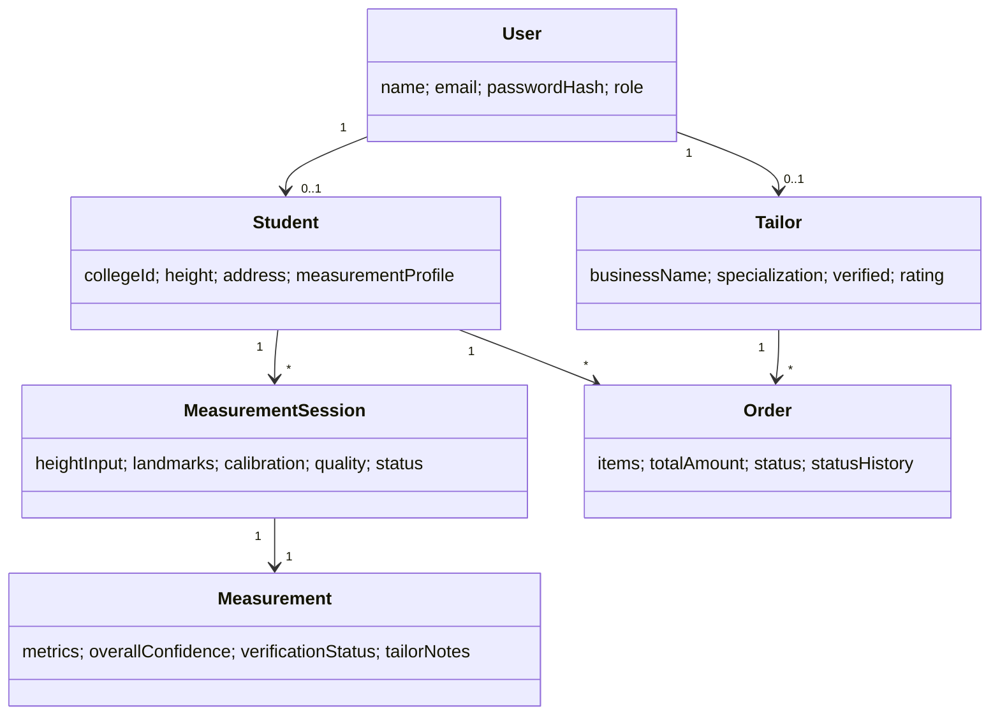

# STICHY Project Documentation

## Abstract

STICHY is a MERN web platform that helps college students order tailored uniforms from local tailors. Its central feature is a browser-based AI measurement workflow that uses the device camera and MediaPipe Pose Landmarker to validate a front and side pose, estimate landmark-based linear measurements, calculate confidence, and require user verification before an order is placed.

## Problem Statement

Conventional uniform ordering often relies on inaccurate self-measurement, repeated tailor visits, and unclear order progress. Students need a clearer way to communicate usable measurements to a tailor without claiming that a phone camera can replace professional fitting.

## Existing and Proposed Systems

The existing system is mostly offline: manual measuring, paper records, and untracked tailoring. STICHY provides student, tailor, and admin portals; a college-specific uniform catalogue; user-confirmed digital profiles; and auditable order status history.

## Objectives and Scope

- Register students and tailors with JWT-protected roles.
- Browse college uniforms and verified tailor profiles.
- Run local camera and MediaPipe pose detection in the browser.
- Save confirmed measurements without default raw-image storage.
- Let tailors review a student-approved profile and update orders.

The current scope is an RGB-camera estimate and workflow demonstration. It is not a replacement for professional measurements or medical body-scanning software.

## Functional Requirements

1. Students and tailors can register and authenticate with role-restricted JWT access.
2. Students can select a college, browse its uniforms, build a cart, select a tailor, and place an order.
3. A student can capture validated front and side camera poses, inspect estimates, manually correct values, and confirm a profile.
4. A tailor can view measurements connected to their orders, add notes, request remeasurement, and adjust values only when the student explicitly allowed it.
5. Tailors can update order status; students can track every status event and review completed orders.
6. Administrators can manage colleges and products through protected REST APIs and inspect platform users.

## Non-functional Requirements

- **Privacy:** raw camera images are not persisted by default; the client sends landmark summaries and measurement results.
- **Security:** bcrypt password hashing, JWT authentication, server-side role checks, CORS, Helmet, rate limiting, input validation, and constrained JSON payload size.
- **Usability:** live camera checklist gives direct correction instructions before capture is enabled.
- **Reliability:** unsupported measurements are `null`, never randomised or invented.
- **Performance:** MediaPipe pose inference runs in the browser to avoid video-upload latency.

## MERN Architecture

```text
React + Tailwind + MediaPipe in browser
        │ REST / JWT
Express + Node controllers and validation
        │ Mongoose
MongoDB collections
```

## AI Measurement Algorithm

1. The student supplies true height in centimetres.
2. `getUserMedia` opens the camera and MediaPipe detects pose landmarks on live frames.
3. The client checks landmark visibility, full body framing, position, shoulder level, posture, brightness, and stability across frames.
4. It captures landmark summaries only for a validated front view and a validated side view.
5. Pixel scale is derived from detected head-to-ankle body height and entered height.
6. Shoulder, arm/sleeve, torso, inseam, shirt, and trouser lengths are converted from landmark geometry to centimetres.
7. Confidence combines visibility, stability, and front/side quality. Measurements with insufficient visual evidence are `null` rather than guessed.
8. The student edits and confirms values; a tailor can then verify them.

## Accuracy and Limitations

An RGB camera cannot directly know centimetres or true body circumference. Camera angle, lens distortion, lighting, clothing, height-entry errors, posture, and perspective affect results. Circumferences such as chest, waist, hip, neck, wrist, thigh, knee, and ankle deliberately remain unavailable in the initial landmark-only implementation unless entered manually. The interface labels all results as approximate and requires verification.

## Database Design

`User` has a one-to-one student or tailor profile. Colleges own products. Students own measurement sessions and profiles. An order connects a student, tailor, college, product items, and a user-verified measurement profile. Reviews attach to delivered orders.

```text
User ── Student ── MeasurementSession ── Measurement ── Order
  └── Tailor ───────────────────────────────────────────────┘
College ── Product ──────────────────────────────────────────┘
```

## ER Diagram



## Data-flow Diagram



## Use Case Diagram



## Measurement Sequence Diagram



## Class / Model Diagram



## Key REST APIs

| Area | Endpoint examples |
|---|---|
| Auth | `POST /api/auth/register`, `POST /api/auth/login`, `GET /api/auth/me` |
| Catalogue | `GET /api/colleges`, `GET /api/products` |
| Profiles | `GET/PUT /api/students/profile`, `PUT /api/tailors/profile` |
| Measurements | `POST/GET /api/measurements`, `GET/PUT/DELETE /api/measurements/:id` |
| Orders | `POST/GET /api/orders`, `GET /api/orders/:id`, `PUT /api/orders/:id/status` |
| Reviews | `POST /api/reviews`, `GET /api/reviews/:tailorId` |

## Testing Plan

- Test registration, login, JWT expiry, and role-denied requests.
- Test catalogue CRUD as an admin and confirm non-admin requests return 403.
- Test camera denied, no-person, low-light, incomplete-body, unstable-pose, front capture, side capture, and low-confidence paths.
- Verify that raw images are not sent in the measurement POST body.
- Test student verification, tailor review, order placement, allowed status transitions, and delivery review creation.

## Results / Expected Demonstration

The demonstration presents a real webcam feed with a MediaPipe skeleton overlay. The capture button remains disabled until live checks pass. After front and side capture, the user receives only geometry-supported estimates, confidence labels, and explicit manual-entry fields for unavailable values. A confirmed profile persists to MongoDB and flows to the assigned tailor when an order is placed.

## Future Scope

Use a consented calibration card or depth camera for stronger scaling, add body segmentation only after privacy review, support tailor-requested live video fitting, payment integration, notifications, delivery partners, audit dashboards, and automated end-to-end tests.
